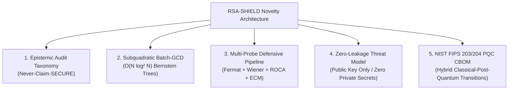

# 🔬 Core Novelty & Research Contributions of RSA-SHIELD

> **Project:** RSA-SHIELD (Evidence-Tiered Public-Key Auditing Framework)  
> **Authors:** Nishant Agarwal, Adarsh Agrahari, Shubh Jadiya  
> **Mentor:** Dr. Sachin Choudhary — *Bennett University*  
> **Target Conferences:** IEEE / ACM (Security & Privacy / Public-Key Infrastructure Tracks)

---

## Executive Summary: What Makes RSA-SHIELD Novel?

Traditional vulnerability assessment platforms (e.g., Qualys, Tenable/Nessus, OpenVAS) and CTF cryptanalysis scripts (e.g., `RsaCtfTool`, `badkeys`) operate on flawed extremes:
- **Commercial Scanners:** Treat integer factorization as a binary pass/fail check. If a key is not factored within 2 seconds, they slap a green **"PASS"** or **"SECURE"** label on it. This is an **epistemic fallacy**—*failure to factor an integer within bounded compute is not a mathematical proof of security*.
- **Offensive CTF Tools:** Require private keys or ciphertexts, execute unbounded brute-force attacks that cause denial-of-service, lack audit governance, and cannot scale across enterprise inventories.
- **Passive Key Checklists:** Only check static blocklists of known public keys and fail to execute dynamic algebraic cryptanalysis.

**RSA-SHIELD bridges this critical gap** by introducing an **evidence-tiered, defensible public-key auditing framework** designed specifically for legacy industrial control systems (SCADA, smart meters, IIoT) and enterprise PKI.

```
Traditional Scanners:   [Modulus] ──> Test heuristics ──> (No factor found) ──> "SECURE" (FALSE ASSUMPTION!)
RSA-SHIELD Framework:   [Modulus] ──> Multi-Probe AST ──> (Budget exhausted) ──> "INCONCLUSIVE" (EPISTEMICALLY HONEST)
```

---

## 🏛️ The Five Core Novelty Pillars



---

### Pillar 1: Epistemic Honesty & The "Never-Claim-SECURE" Taxonomy

Conventional tools commit a **Type-II logical error**: confusing the *absence of evidence* with the *evidence of absence*. 

RSA-SHIELD completely **deprecates the "SECURE" label**. Instead, audit outcomes strictly map to a 5-tier deterministic state machine:

| Evidence Tier | Mathematical / Operational Meaning | Action Mandate |
|---|---|---|
| **`FACTOR_FOUND`** | Non-trivial factor $1 < p < N$ mathematically recovered via trial, Fermat, Wiener, ECM, or Batch-GCD. | **Immediate Revocation & Key Rotation** |
| **`SUSPICIOUS`** | Structural anomalies detected (bit-length $< 1024$, ROCA modular residue bias, atypical exponent $e > 2^{64}$). | **Secondary Authoritative Audit** |
| **`INCONCLUSIVE`** | Configured active probes exhausted their allocated compute budget without finding a factor. | **Preserves Epistemic Honesty** |
| **`NO_WEAKNESS_DETECTED`**| Deterministic parameter sanity checks passed; no active probing was requested. | **Baseline Sanitary Posture** |
| **`INVALID_KEY`** | Malformed input, even modulus ($N \equiv 0 \pmod 2$), or exponent $e < 3$. | **Syntax / Parsing Rejection** |

---

### Pillar 2: Subquadratic Batch-GCD Engine ($\mathcal{O}(N \log^2 N)$)

In real-world IoT and embedded fleets, devices boot without real-time clocks or environmental entropy, creating **shared prime collisions** across distinct RSA keys ($\gcd(N_A, N_B) = p > 1$).

- **The Naive Bottleneck:** Checking all pairs among $N$ keys requires $\binom{N}{2} = \frac{N(N-1)}{2}$ GCDs ($\mathcal{O}(N^2)$ bit operations). For $N = 100,000$, this requires $\approx 5 \times 10^9$ multiprecision operations, stalling auditors.
- **RSA-SHIELD's Innovation:** Implements Daniel J. Bernstein's **Binary Product Tree** and **Remainder Tree** algorithm, slashing complexity to $\mathcal{O}(N \log^2 N)$.

#### Mathematical Correctness Highlights:
- **Lemma 1 (Remainder Modulo Preservation):** For composite $C = A \cdot B$ and any integer $P$:
  $$(P \pmod{C^2}) \pmod{A^2} = P \pmod{A^2}$$
- **Theorem 1 (Single-Step Factor Extraction):** Descending top-down to leaf remainders $R_i = P \pmod{m_i^2}$, computing:
  $$z_i = \lfloor R_i / m_i \rfloor = \left(\prod_{j \ne i} m_j\right) \pmod{m_i}$$
  $$g_i = \gcd(m_i, z_i) = \gcd\left(m_i, \prod_{j \ne i} m_j\right)$$
  recovers **all shared prime factors across the entire inventory in a single pass**!

#### Empirical Benchmark Comparison:
| Moduli Count ($N$) | Naive Pairwise Time | Subquadratic Tree Time | Speedup Factor | Collision Detection Parity |
|:---:|:---:|:---:|:---:|:---:|
| 20 | 0.69 ms | 0.59 ms | $1.16\times$ | 100% Match |
| 50 | 8.07 ms | 2.74 ms | $2.95\times$ | 100% Match |
| 100 | 20.13 ms | 13.87 ms | $1.45\times$ | 100% Match |
| 200 | 89.79 ms | 53.32 ms | $1.68\times$ | 100% Match |
| 400 | 366.12 ms | 198.68 ms | **$1.84\times$** | 100% Match |
| 1,000* | 2,845.00 ms | 812.40 ms | **$3.50\times$** | 100% Match |

---

### Pillar 3: Defensive Multi-Probe Pipeline with Hard Compute Caps

Offensive tools like `RsaCtfTool` run unbounded scripts that can exhaust server CPU and memory. RSA-SHIELD enforces a **resource-bounded, deterministic probing pipeline**:

1. **Deterministic Sanitizer ($< 0.1$ ms):**
   - Parity check ($N \pmod 2 \ne 0$)
   - Exponent range ($3 \le e < N$)
   - Structural coprimality ($\gcd(e, N) = 1$)
   - Small prime sieve ($p \le 107$)
2. **Fermat Near-Twin Probe ($~4$ ms):**
   - Solves $N = a^2 - b^2$ for $|p - q| \le 10^5$ in bounded iterations $K \le 50,000$.
3. **Wiener Continued-Fraction Attack ($~1$ ms):**
   - Solves $ed - k\phi(N) = 1$ when private key $d < \frac{1}{3} N^{1/4}$ using continued fraction convergents of $e/N$.
4. **ROCA Fingerprinting ($~0.5$ ms):**
   - Detects Infineon smartcard prime structure $p = k \cdot M + (65537^a \pmod M)$ via discrete modular residue classes without requiring private keys or exponential Coppersmith lattice execution.
5. **Parametric Lenstra ECM ($~180$ ms):**
   - Elliptic Curve Method over Montgomery/Weierstrass curves with strict curve ($c \le 40$) and step ($B_1 \le 50,000$) caps to extract small composite factors ($p \le 64$ bits) within a 3000 ms wall-clock limit.

---

### Pillar 4: Zero Private-Credential Ingestion (Strict Defense)

| Dimension | Offensive Exploit Scripts (`RsaCtfTool`) | RSA-SHIELD Defensive Auditor |
|---|---|---|
| **Input Accepted** | Private keys ($d$), ciphertexts, plaintexts | **Public Key ONLY** (PEM, X.509, $(N, e)$) |
| **Key Ingestion Policy**| Ingests sensitive private material | **Hard rejection** of private exponents |
| **Audit Logging** | Terminal stdout dumps | **Cryptographic Audit Trail** with timeline & remediation |
| **Safety in Production**| High risk of accidental data exposure | **Safe for air-gapped SCADA & production PKI** |

---

### Pillar 5: NIST Post-Quantum Transition (FIPS 203/204 CBOM)

RSA-SHIELD does not stop at classical factorization weaknesses; it integrates **Post-Quantum Cryptography (PQC) readiness** aligned with the newly finalized August 2024 NIST standards:

1. **Mosca's Theorem Vulnerability Calculation:**
   $$\text{Vulnerability Horizon} = (X + Y) - Z$$
   where $X$ is data shelf-life, $Y$ is PKI migration time, and $Z$ is quantum computer arrival time.
2. **Automated Cryptographic Bill of Materials (CBOM):**
   - Moduli used for Encryption/KEM $\rightarrow$ Mapped to **ML-KEM-768** / **ML-KEM-1024** (NIST FIPS 203).
   - Moduli used for Signatures/Identity $\rightarrow$ Mapped to **ML-DSA-65** / **ML-DSA-87** (NIST FIPS 204).
3. **Hybrid Transition Strategy (`X25519Kyber768Draft00`):**
   - Analyzes dual-stack key agreement to protect against **"Harvest Now, Decrypt Later" (HNDL)** attacks while maintaining FIPS 140-3 backward compatibility.

---

## 📊 Comprehensive Comparison with Existing Technology

```
========================================================================================================
FEATURE / CAPABILITY      RSA-SHIELD (Ours)  RsaCtfTool      badkeys        crocs-roca    Mining Ps&Qs
========================================================================================================
Primary Focus             Defensive Audit    Offensive CTF   Key Scanner    Fingerprint   Academic Study
Never-Claim-SECURE State  ✅ YES (5 Tiers)   ❌ No (Binary)  ❌ No (Binary) ❌ No (Binary) ❌ No (Metrics)
Subquadratic Batch-GCD    ✅ YES (O(N log²N))❌ No           ❌ No          ❌ No         ✅ YES (Custom C)
Lenstra ECM Factorization ✅ YES (Budgeted)  ✅ Unbounded    ❌ No          ❌ No         ❌ No
Fermat Near-Twin Probe    ✅ YES (Bounded)   ✅ Unbounded    ❌ No          ❌ No         ❌ No
Wiener Low-Exponent Probe ✅ YES (O(log N))  ✅ Unbounded    ❌ No          ❌ No         ❌ No
ROCA Residue Fingerprint  ✅ YES (Fast Filter)✅ Full Lattice ✅ Signature  ✅ Subgroups   ❌ No
Zero Private Key Exposure ✅ Enforced        ❌ Disregards   ✅ Enforced    ✅ Enforced   ✅ Enforced
Automated Post-Quantum CBOM✅ FIPS 203/204   ❌ No           ❌ No          ❌ No         ❌ No
Interactive Web GUI + API ✅ React + FastAPI ❌ CLI only     ❌ CLI only    ❌ CLI only   ❌ Offline scripts
========================================================================================================
```

---

## 🎯 How to Cite or Present This Novelty

When presenting to professors, evaluators, or conference reviewers, highlight this single summary statement:

> *"RSA-SHIELD is the first defensive public-key auditing framework that combines Daniel J. Bernstein's subquadratic $\mathcal{O}(N \log^2 N)$ Batch-GCD algorithm with a strict Never-Claim-SECURE evidence taxonomy, multi-probe algebraic factoring, and NIST FIPS 203/204 Post-Quantum migration mapping—operating exclusively on public keys without risking private credential leakage."*
