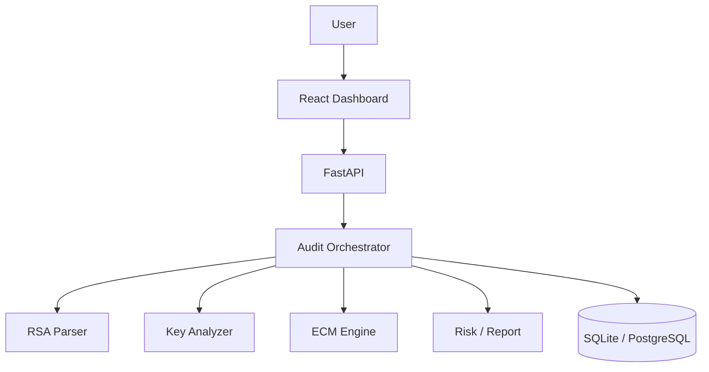

# RSA-SHIELD

**RSA Key Security Auditor for Legacy Critical Infrastructure**  
Team Aegis · Bennett University · Mentor: Dr. Sachin Choudhary

## Overview

RSA-SHIELD is a software-only cybersecurity platform that accepts RSA **public** keys/moduli, analyzes cryptographic properties, runs budgeted Lenstra ECM factorization attempts, and produces evidence-tiered audit results.

**Important:** failure to factor a key is **never** labeled “SECURE”.

Result states:

- `FACTOR_FOUND`
- `SUSPICIOUS`
- `INCONCLUSIVE`
- `NO_WEAKNESS_DETECTED_BY_CONFIGURED_CHECKS`
- `INVALID_KEY`

## Architecture



## Tech stack

| Layer | Stack |
|-------|--------|
| Frontend | React, TypeScript, Vite, Tailwind CSS v4, Recharts, React Router |
| Backend | Python, FastAPI, Pydantic, SQLAlchemy, PyCryptodome |
| Crypto | RSA parse/analyze + Lenstra ECM (budgeted) |
| Data | SQLite by default (`rsa_shield.db`) |

## Quick start

### Backend

```bash
cd backend
python -m venv .venv
# Windows:
.venv\Scripts\activate
pip install -r requirements.txt
copy .env.example .env
uvicorn app.main:app --reload --port 8000
```

API docs: http://127.0.0.1:8000/docs

### Frontend

```bash
cd frontend
npm install
npm run dev
```

App: http://127.0.0.1:5173

### Tests

```bash
cd backend
.venv\Scripts\python -m pytest -q
```

## Demo walkthrough (~3 min)

1. Open landing → **Explore Test Lab**
2. Run **Intentionally weak RSA (ECM demo)** → expect `FACTOR_FOUND`
3. Open audit details → review evidence + timeline
4. **Generate report** (JSON download)
5. Run **Normal demonstration RSA key** with short budget → typically `INCONCLUSIVE`
6. Emphasize: inconclusive ≠ secure

## Security considerations

- Public keys/moduli only; private keys rejected
- Input size limits; no shelling out
- ECM timeouts / curve budgets
- Authorized / lab keys only

## Limitations

- Educational prototype ECM — not a claim to break modern strong RSA
- No factor within budget is inconclusive
- SQLite default (swap `DATABASE_URL` for Postgres)

## License / academic use

College project prototype for cybersecurity coursework at Bennett University.
