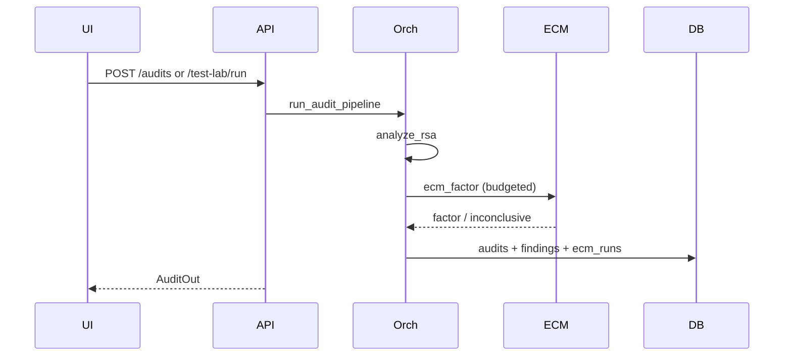

# Architecture

RSA-SHIELD separates HTTP, persistence, and cryptographic logic.

## Components

- **Frontend**: React SPA (Vite) talking to `/api/v1`
- **API**: FastAPI routers + Pydantic validation
- **Audit orchestrator**: validate → analyze → ECM → classify → persist
- **Crypto modules**: PEM/raw parser, deterministic analyzer
- **ECM engine**: budgeted Lenstra ECM (Weierstrass) + trial division
- **DB**: SQLAlchemy async (SQLite default)

## Data flow

## Classification policy

Never emit absolute SECURE. Use FACTOR_FOUND / SUSPICIOUS / INCONCLUSIVE / NO_WEAKNESS_DETECTED_BY_CONFIGURED_CHECKS / INVALID_KEY.
